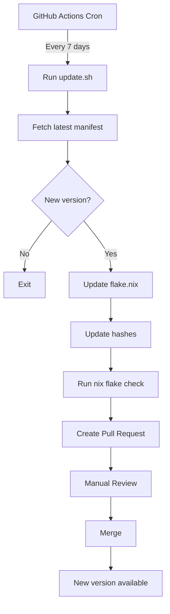

# Architecture

This document describes the technical architecture of the Antigravity Nix flake.

## Overview

The flake provides a reproducible, declarative way to install and manage Antigravity CLI across different systems using Nix.

## Components

### 1. Flake Structure

```
flake.nix           # Main flake definition
├── inputs          # Dependencies (nixpkgs, flake-utils)
└── outputs         # Packages, apps, devShells
```

### 2. Version Management

**Manifest API:**
- Base URL: `https://antigravity-cli-auto-updater-974169037036.us-central1.run.app`
- Endpoint: `/manifests/{platform}.json`
- Returns: version, download URL, SHA-512 checksum

**Platform Mapping:**
```nix
{
  "x86_64-linux"   = "linux_amd64";
  "aarch64-linux"  = "linux_arm64";
  "x86_64-darwin"  = "darwin_amd64";
  "aarch64-darwin" = "darwin_arm64";
}
```

### 3. Build Process

```
1. Fetch manifest from Google's API
2. Download tarball from Google Cloud Storage
3. Verify SHA-512 checksum
4. Extract binary
5. Patch ELF (Linux only) using autoPatchelfHook
6. Install to Nix store
```

### 4. Security

**Checksum Verification:**
- SHA-512 hashes fetched from official manifest
- Nix verifies hash before extraction
- Build fails if hash mismatch

**Source Verification:**
- Only downloads from `storage.googleapis.com`
- Official Google Cloud Storage bucket
- HTTPS-only connections

### 5. Auto-Update Workflow



**Workflow Steps:**
1. Scheduled trigger (every 7 days)
2. Fetch manifests for all platforms
3. Compare versions
4. Update `flake.nix` with new version and hashes
5. Verify build with `nix flake check`
6. Create PR with changes
7. Manual review and merge

### 6. Package Definition

```nix
stdenv.mkDerivation {
  pname = "antigravity";
  version = "1.0.0";
  
  src = fetchurl {
    url = "https://storage.googleapis.com/...";
    hash = "sha512-...";
  };
  
  nativeBuildInputs = [ autoPatchelfHook ];
  buildInputs = [ stdenv.cc.cc.lib ];
  
  installPhase = ''
    install -m755 antigravity $out/bin/antigravity
  '';
}
```

**Key Features:**
- `autoPatchelfHook`: Fixes dynamic linking for NixOS
- `stdenv.cc.cc.lib`: Provides required C++ runtime
- Fixed-output derivation: Reproducible builds

### 7. Multi-Platform Support

**Current Status:**
- ✅ Linux x86_64: Fully supported
- ⏳ Linux ARM64: Manifest available, testing needed
- ⏳ macOS x86_64: Manifest available, testing needed
- ⏳ macOS ARM64: Manifest available, testing needed

**Platform Detection:**
```nix
system = "x86_64-linux";
platform = platformMap.${system};  # "linux_amd64"
```

### 8. Development Shell

Provides a development environment with Antigravity pre-installed:

```nix
devShells.default = pkgs.mkShell {
  buildInputs = [ antigravity ];
  shellHook = ''
    echo "Antigravity development environment"
  '';
};
```

### 9. Flake Apps

Direct execution without installation:

```nix
apps.default = {
  type = "app";
  program = "${antigravity}/bin/antigravity";
};
```

## Data Flow

### Installation Flow

```
User Command
    ↓
Nix Evaluates flake.nix
    ↓
Fetches nixpkgs and flake-utils
    ↓
Determines system platform
    ↓
Fetches tarball (with hash verification)
    ↓
Extracts binary
    ↓
Patches ELF (Linux)
    ↓
Installs to /nix/store
    ↓
Creates symlink in profile
```

### Update Flow

```
GitHub Actions Trigger
    ↓
scripts/update.sh
    ↓
Fetch manifests from API
    ↓
Parse JSON (version, URL, hash)
    ↓
Convert hex SHA-512 to SRI format
    ↓
Update flake.nix via awk
    ↓
Verify with nix flake check
    ↓
Commit and create PR
```

## File Structure

```
.
├── .github/
│   ├── ISSUE_TEMPLATE/
│   │   ├── bug_report.md
│   │   └── feature_request.md
│   ├── PULL_REQUEST_TEMPLATE.md
│   └── workflows/
│       └── update.yml          # Auto-update workflow
├── docs/
│   ├── ARCHITECTURE.md         # This file
│   └── SETUP.md               # Setup guide
├── scripts/
│   └── update.sh              # Update script
├── CHANGELOG.md               # Version history
├── CONTRIBUTING.md            # Contribution guide
├── LICENSE                    # MIT license
├── README.md                  # Main documentation
├── flake.lock                 # Locked dependencies
└── flake.nix                  # Flake definition
```

## Dependencies

### Build-time
- `nixpkgs`: Nix packages collection
- `flake-utils`: Flake utilities
- `autoPatchelfHook`: ELF patcher for NixOS
- `stdenv.cc.cc.lib`: C++ runtime

### Runtime
- None (statically linked binary)

## Design Decisions

### Why Nix Flakes?

1. **Reproducibility**: Lock file ensures consistent builds
2. **Declarative**: Clear dependency specification
3. **Composable**: Easy integration with other flakes
4. **Modern**: Latest Nix features and best practices

### Why Auto-Updates?

1. **Convenience**: Users get latest features automatically
2. **Security**: Timely security updates
3. **Maintenance**: Reduces manual update burden
4. **Transparency**: PR-based updates allow review

### Why SHA-512?

1. **Security**: Stronger than SHA-256
2. **Official**: Used by Antigravity's installer
3. **Verification**: Ensures download integrity

### Why autoPatchelfHook?

1. **NixOS Compatibility**: Fixes dynamic linking
2. **Automatic**: No manual patching needed
3. **Standard**: Common practice for binary packages

## Future Enhancements

1. **Multi-platform Testing**: CI for all platforms
2. **Binary Cache**: Speed up installations
3. **Version Pinning**: Allow specific version selection
4. **Plugin Support**: Package Antigravity plugins
5. **Overlay**: Provide as Nixpkgs overlay

## References

- [Nix Flakes](https://nixos.wiki/wiki/Flakes)
- [Nixpkgs Manual](https://nixos.org/manual/nixpkgs/stable/)
- [Antigravity CLI](https://antigravity.google)
